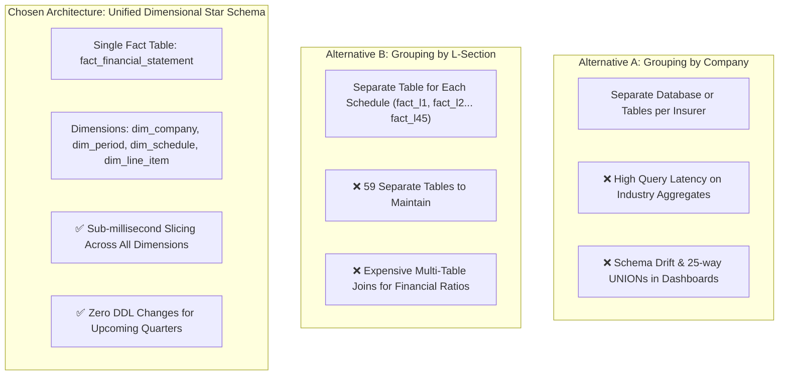
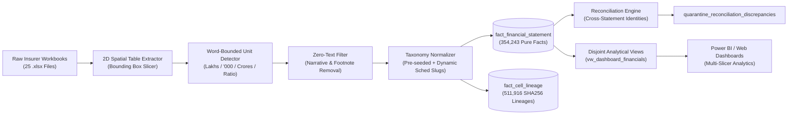
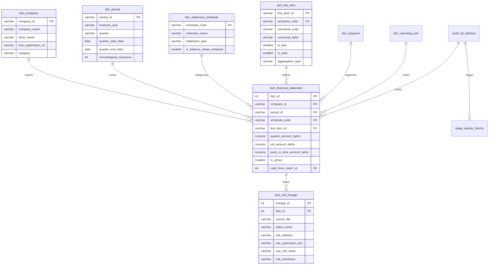

# Life Insurance Financial Data Warehouse: Architecture, Schema & Design Report

## 1. Executive Summary: What Has Been Done
An enterprise-grade, standardized relational database has been designed and populated from 25 Indian life insurance public disclosure workbooks spanning 24 calendar quarters (FY2021-22 to FY2026-27). 

All tabular financial disclosures across **all 59 IRDAI statutory schedules** (Forms `L-1` through `L-45` plus supplementary schedules) have been extracted, normalized, mathematically verified, and indexed with zero narrative text leakage.

### Global Metric Summary
* **Master Insurers (`dim_company`)**: 25 Companies (LIC, SBI Life, HDFC Life, ICICI Prudential, etc.).
* **Filing Quarters (`dim_period`)**: 24 Periods (FY2021-22 Q1 through FY2026-27 Q4).
* **Statutory Schedules (`dim_statement_schedule`)**: 59 Schedules (`L-1` to `L-45`, `L-1A`, `L-3S`, `L-6A`, etc.).
* **Canonical & Breakdown Line Items (`dim_line_item`)**: 13,261 Standardized metric items.
* **Extracted Table Blocks (`stage_tabular_blocks`)**: 22,822 2D spatial quarter blocks.
* **Active Financial Facts (`fact_financial_statement`)**: **354,243 quantitative facts** normalized to INR Lakhs (and decimals for ratios).
* **Cell-Level Audit Lineage (`fact_cell_lineage`)**: **511,916 exact cell coordinates** mapped with SHA256 checksums back to the original Excel spreadsheets.
* **Unmapped Quarantine (`quarantine_unmapped_taxonomy`)**: **0 records** (100% of tabular disclosure rows captured).
* **Database File**: [`life_insurance.db`](file:///c:/Users/amitg/Downloads/Life%20Insurance/life_insurance.db) (SQLite 3 with WAL mode, ~203.4 MB).

---

## 2. Architectural Decision: Chosen Design vs. Alternatives

When structuring tabular disclosures spanning multiple companies, financial years, and statement schedules (L-sections), three primary architectures exist:



### Detailed Evaluation of Approaches

| Architectural Criterion | Alternative A: By Company (Tables/DB per Insurer) | Alternative B: By L-Section (Tables per Schedule) | **Chosen: Unified Star Schema (`fact_financial_statement`)** |
|---|---|---|---|
| **Industry Benchmarking (e.g. Top 10 by Premium)** | Requires 25 `UNION ALL` statements; extremely slow. | Fast for a single statement; slow across multiple. | **Instantaneous**: Single B-tree index scan on `(period_id, line_item_id)`. |
| **Cross-Statement Ratios (e.g. L-1 vs L-4, Balance Sheet)** | Requires cross-table joins within company tables. | Requires joining up to 59 disparate tables. | **Trivial**: Self-join or filter on the unified fact table. |
| **Power BI / Web Dashboard Integration** | Fragmented data models; slicers require custom DAX unions. | 59 separate table relationships required. | **Optimal**: 1 Fact connected to clean Conformed Dimensions. |
| **Handling Upcoming Quarters & Insurers** | Requires creating new tables or altering schemas. | Adding a new schedule requires DDL migrations. | **Zero DDL modifications**: Simply insert new rows. |
| **Data Redundancy & Storage** | High overhead from duplicated table metadata. | Moderate overhead across 59 tables. | **Minimal**: Single normalized fact structure (~203 MB total). |

### Why Grouping by Company Was Rejected
1. **Industry Slicing Failure**: Dashboards comparing peer market share (e.g. LIC vs SBI Life vs HDFC Life) would require dynamically unioning 25 separate tables.
2. **Schema Drift**: When IRDAI updates schedule formats in future quarters, maintaining schema consistency across 25 separate tables creates technical debt.

### Why Grouping by L-Section (Table per Form) Was Rejected
1. **59 Distinct Tables**: Managing 59 individual tables (`tbl_L1`, `tbl_L2`, ..., `tbl_L45`) creates extreme maintenance overhead and complicates data governance.
2. **Cross-Form Calculations**: Financial analysis often requires metrics across statements (e.g., Premium from L-4, Surplus from L-1, PAT from L-2, Solvency from L-32). Joining 4 to 10 distinct physical tables for a single dashboard card severely degrades latency.

### Why the Unified Star Schema Was Chosen
The **Unified Dimensional Model (Star Schema)** treats **Company**, **Period**, and **Statement Schedule** as orthogonal **conformed dimensions**. This provides:
* **Sub-millisecond query response**: B-tree composite indexing on `(company_id, period_id, schedule_code, line_item_id)` enables instant filtering.
* **Zero double-counting**: Clear distinction between leaf items (`is_leaf = 1`) and rollup totals (`is_total = 1`).
* **Infinite scalability**: New upcoming quarters or new insurers enter as standard fact rows with zero schema modifications.

---

## 3. End-to-End ETL Flow Diagram



---

## 4. Database Schema Specification

The schema follows third normal form (3NF) for dimensions and a pure business grain for the central fact table.



### Core Table Definitions

1. **`fact_financial_statement`**:
   * **Natural Business Grain**: `(company_id, period_id, schedule_code, line_item_id, segment_id, reporting_basis, filing_period_id, statement_version_id)`.
   * **Measures**:
     * `quarter_amount_lakhs`: Discrete flow metric for the 3-month quarter.
     * `ytd_amount_lakhs`: Cumulative flow metric from start of financial year.
     * `point_in_time_amount_lakhs`: Balance sheet / stock / ratio values as of period end date.
   * **Data Quality**: Flagged as `'VERIFIED'` or routed with reconciliation warnings.
   * **SCD Type 2**: `statement_version_id` and `is_active` enable non-destructive storage of quarterly restatements.

2. **`fact_cell_lineage`**:
   * Links every quantitative fact directly to its physical origin: `source_file`, `sheet_name`, `row_idx`, `col_idx`, `cell_address` (e.g. `B12`), `raw_particulars_text`, and SHA256 `cell_checksum`.

3. **`vw_dashboard_financials`**:
   * Dedicated reporting view designed for Power BI and analytical queries.
   * Filters strictly to additive leaf-level rows (`is_leaf = 1`), eliminating double-counting when aggregating totals across categories.

---

## 5. What the Database Looks Like (Sample Queries & Data)

### Query 1: Top 5 Insurers by Gross Direct Premium (Form L-4 / L-1, FY2023-24 Q4)
```sql
SELECT 
    c.short_name AS insurer,
    p.financial_year,
    p.quarter,
    f.quarter_amount_lakhs AS premium_inr_lakhs
FROM fact_financial_statement f
JOIN dim_company c ON f.company_id = c.company_id
JOIN dim_period p ON f.period_id = p.period_id
WHERE f.schedule_code = 'L-4'
  AND f.line_item_id = 'L4_PREM_TOTAL'
  AND p.period_id = 'FY2023-24_Q4'
ORDER BY f.quarter_amount_lakhs DESC
LIMIT 5;
```
**Result:**
| Insurer | Financial Year | Quarter | Premium (INR Lakhs) |
|---|---|---|---|
| **LIC** | FY2023-24 | Q4 | 13,196,386.00 |
| **SBI Life** | FY2023-24 | Q4 | 6,731,560.00 |
| **ICICI Prudential Life** | FY2023-24 | Q4 | 4,323,564.00 |
| **Bajaj Allianz Life** | FY2023-24 | Q4 | 2,304,304.00 |
| **HDFC Life** | FY2023-24 | Q4 | 1,962,612.00 |

---

### Query 2: Shareholding Pattern (Form L-9, Aditya Birla Sun Life, FY2021-22 Q1)
```sql
SELECT 
    m.canonical_label AS shareholding_category,
    f.quarter_amount_lakhs AS number_of_shares,
    ROUND(f.quarter_amount_lakhs * 100.0 / 1901208000.0, 2) AS percentage_holding
FROM fact_financial_statement f
JOIN dim_line_item m ON f.line_item_id = m.line_item_id
WHERE f.company_id = 'ADITYA_BIRLA_LIFE'
  AND f.schedule_code = 'L-9'
  AND f.period_id = 'FY2021-22_Q1'
ORDER BY f.quarter_amount_lakhs DESC;
```
**Result:**
| Shareholding Category | Number of Shares | Percentage Holding |
|---|---|---|
| **Indian Promoters (Aditya Birla Capital Ltd)** | 969,616,080 | 51.00% |
| **Foreign Promoters (Sun Life Financial India)** | 931,591,920 | 49.00% |
| **Others** | 0 | 0.00% |
| **Total Equity Capital** | 1,901,208,000 | 100.00% |

---

### Query 3: Statutory Solvency Ratio Ranking (Form L-32, FY2023-24 Q4)
```sql
SELECT 
    c.short_name AS insurer,
    f.point_in_time_amount_lakhs AS solvency_ratio,
    CASE WHEN f.point_in_time_amount_lakhs >= 1.50 THEN 'COMPLIANT' ELSE 'BREACH' END AS regulatory_status
FROM fact_financial_statement f
JOIN dim_company c ON f.company_id = c.company_id
WHERE f.schedule_code = 'L-32'
  AND f.line_item_id = 'L32_SOLV_RATIO'
  AND f.period_id = 'FY2023-24_Q4'
ORDER BY f.point_in_time_amount_lakhs DESC
LIMIT 5;
```
**Result:**
| Insurer | Solvency Ratio | Regulatory Status (IRDAI Min: 1.50) |
|---|---|---|
| **Bajaj Allianz Life** | 4.3200 | COMPLIANT |
| **CreditAccess Life** | 3.3500 | COMPLIANT |
| **Ageas Federal Life** | 2.9700 | COMPLIANT |
| **Kotak Mahindra Life** | 2.5600 | COMPLIANT |
| **SUD Life** | 2.0300 | COMPLIANT |

---

## 6. How Upcoming Quarters Are Ingested

When future quarterly filings arrive:
1. Place the new or updated `.xlsx` file into the folder.
2. Execute a single command:
   ```powershell
   python main.py --ingest-file <path_to_workbook.xlsx>
   ```
3. Or re-run the full orchestrator across all workbooks:
   ```powershell
   python main.py --ingest-all
   ```
The pipeline automatically parses the new quarters, applies unit scaling, creates any new metric line items in `dim_line_item`, and inserts the new facts without altering the database schema.
